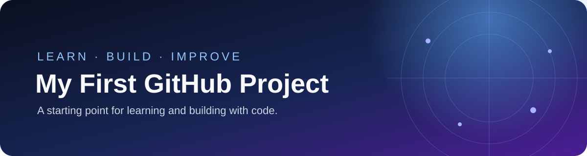

# Razi
### Aspiring AI Developer · Python · Intelligent Robotics

Learning by building, experimenting, and documenting my progress.

---

## About

- Exploring **Python, artificial intelligence, and robotics**
- Building small projects to turn concepts into practical skills
- Documenting my learning journey and improving one project at a time

## Current Focus

| Area | Focus |
| --- | --- |
| Python | Programming fundamentals and practical projects |
| AI & Machine Learning | Core concepts and beginner experiments |
| Robotics | Connecting code with the physical world |
| Web Development | Building and improving useful tools |

## Featured Work

- **[AI Learning Journey](https://github.com/moeinim351-afk/ai-learning-journey)** — notes, experiments, and projects from my learning path.
- **[My First GitHub Project](https://github.com/moeinim351-afk/my-first-github-project)** — an early step in learning to organize and share code.

## Mini Projects

Three small, working browser projects built with **HTML, CSS, and JavaScript**. No installation or API key required.

| Project | What it does | Open source |
| --- | --- | --- |
| **FocusFlow — Study Planner** | Add study tasks, set priority, track completion, and save locally in your browser. | [Open project](projects/focusflow-study-planner/index.html) · [README](projects/focusflow-study-planner/README.md) |
| **Math Quest — Math Quiz** | Answer five multiple-choice math questions, get explanations, and earn a score out of 100. | [Open project](projects/math-quest-quiz/index.html) · [README](projects/math-quest-quiz/README.md) |
| **Pocket+ — Expense Tracker** | Record sample income and expenses and see your balance update automatically. | [Open project](projects/pocket-expense-tracker/index.html) · [README](projects/pocket-expense-tracker/README.md) |

### Run locally
1. Open the project folder you want.
2. Download its `index.html` file.
3. Double-click `index.html` to open it in a modern browser.

These are beginner portfolio projects, not production services. Their data is stored in the current browser using `localStorage`.

## GitHub Overview

---

  Learning consistently. Building thoughtfully. Improving with every project.

